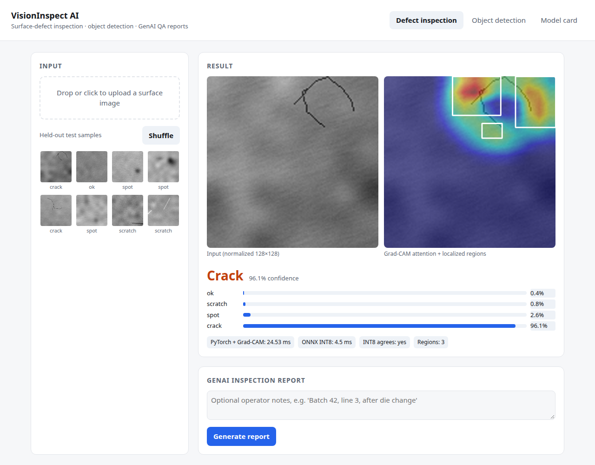
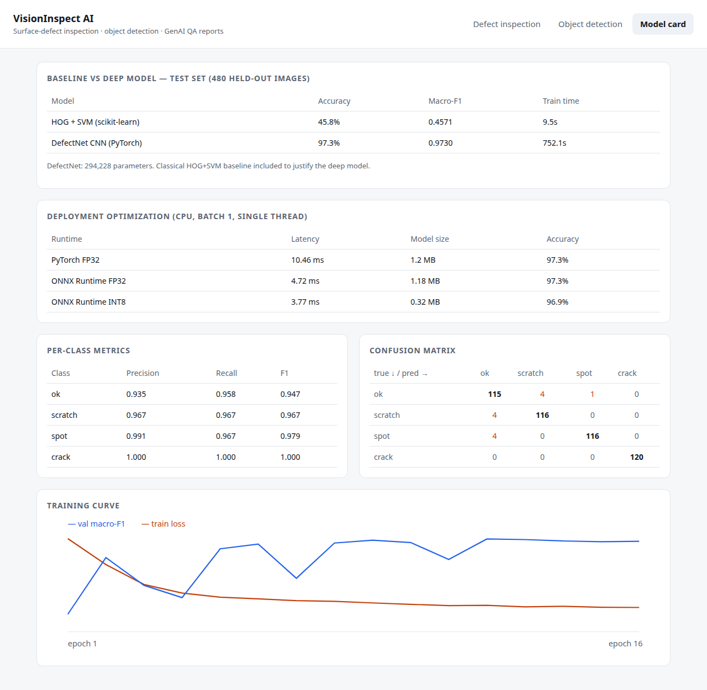

# VisionInspect AI

An end-to-end computer-vision system for **automated surface-defect inspection**, the kind used on
manufacturing lines for steel, aluminium, glass and PCB QA. It covers the full ML lifecycle:
data → classical baseline → deep model → explainability → optimization → API → GenAI reporting → container.

| | |
|---|---|
| **Defect classifier** | Custom PyTorch CNN, **97.3% test accuracy** (4 classes, 480 held-out images) |
| **Classical baseline** | HOG (hand-written in NumPy/OpenCV) + RBF-SVM (scikit-learn), 45.8% |
| **Explainability / localization** | Grad-CAM heatmaps → OpenCV contours → defect bounding boxes |
| **Optimization** | ONNX export + INT8 static quantization: **2.8× faster than PyTorch, 3.7× smaller, −0.4 pt accuracy** |
| **Object detection** | Pretrained SSDLite-MobileNetV3 (COCO, 80 classes) on CPU |
| **GenAI** | Claude (vision + structured JSON output) writes the QA report and cross-checks the CNN |
| **Serving** | FastAPI REST API + web UI, Docker image, pytest suite |



📘 **Full technical documentation:** [docs/DOCUMENTATION.md](docs/DOCUMENTATION.md)

---

## How it maps to the role

| Requirement | Where it lives |
|---|---|
| Python, ML & Deep Learning | `ml/train.py`, `ml/model.py` |
| Computer Vision *(mandatory)* | Synthetic defect generation, HOG, Grad-CAM localization, object detection: `ml/dataset.py`, `app/inference.py` |
| TensorFlow / PyTorch / OpenCV / scikit-learn | PyTorch (training, Grad-CAM, torchvision detection), OpenCV (data, features, contours, drawing), scikit-learn (SVM, metrics) |
| NLP / Generative AI / LLMs | `app/llm.py`: multimodal LLM, schema-constrained JSON output, refusal fallback |
| Model development, training, optimization, deployment | AdamW + OneCycle + label smoothing + early stopping; ONNX + INT8 QDQ quantization; Docker |
| REST APIs, FastAPI | `app/main.py`: typed endpoints, upload limits, error mapping, OpenAPI docs at `/docs` |
| Cloud (AWS / Azure / GCP) | Stateless container that runs as-is on ECS/Fargate, Azure Container Apps or Cloud Run (see below) |
| R&D / problem solving | See "Engineering notes": the dynamic→static quantization finding |

---

## Results

Held-out test set: 480 images (120 per class), never seen in training or model selection.

| Model | Accuracy | Macro-F1 | Train time (4-core CPU) |
|---|---|---|---|
| HOG + SVM (scikit-learn) | 45.8% | 0.457 | 10 s |
| **DefectNet CNN (PyTorch, 294k params)** | **97.3%** | **0.973** | 12.5 min |

| Runtime (batch 1, single thread) | Latency | Size | Accuracy |
|---|---|---|---|
| PyTorch FP32 | 10.5 ms | 1.20 MB | 97.3% |
| ONNX Runtime FP32 | 4.7 ms | 1.18 MB | 97.3% |
| **ONNX Runtime INT8 (static, QDQ)** | **3.8 ms** | **0.32 MB** | **96.9%** |

Confusion is almost entirely between `ok` and faint `scratch`/`spot` samples. Cracks are 100%.
The UI flags any prediction below 85% confidence for **manual review** rather than auto-passing it.



---

## Architecture

```
            ┌──────────── offline (ml/) ─────────────┐
 dataset.py │ OpenCV synthetic textures + defects    │
            │      ↓                                 │
 train.py   │ HOG+SVM baseline   DefectNet CNN       │
            │                       ↓                │
            │       ONNX export → INT8 static quant  │──► artifacts/
            └────────────────────────────────────────┘
                                                        │
            ┌──────────── online (app/) ─────────────┐  ▼
 main.py    │ FastAPI                                │
            │  POST /api/inspect → CNN + Grad-CAM → contours → boxes
            │  POST /api/detect  → SSDLite MobileNetV3 (COCO)
            │  POST /api/report  → Claude: image + CNN JSON → structured QA report
            │  GET  /api/metrics → model card
            └────────────────────────────────────────┘
```

### Why the GenAI layer exists
The CNN is fast and accurate but only outputs a label. The LLM turns that into what a QA engineer
actually files: disposition (accept / rework / scrap / manual review), severity, likely root causes and
corrective actions. It also **looks at the image itself** and reports whether it agrees with the CNN,
which gives a second opinion on borderline cases. Output is constrained to a JSON schema, so the
downstream system never has to parse free text.

---

## Quickstart

```bash
python3 -m venv .venv && source .venv/bin/activate
pip install -r requirements-dev.txt

python -m ml.dataset --per-class 800     # ~5 s, writes data/{train,val,test}
python -m ml.train                       # ~13 min on CPU, writes artifacts/
python -m ml.train --export-only         # redo ONNX/quantization only

cp .env.example .env                     # optional: add ANTHROPIC_API_KEY for GenAI reports
uvicorn app.main:app --reload            # http://localhost:8000  (API docs: /docs)
pytest -q
```

Trained artifacts are committed in `artifacts/`, so you can skip training and go straight to `uvicorn`
(you still need `python -m ml.dataset` for the sample gallery).

Everything except `/api/report` runs fully offline. Without an API key, that endpoint returns `503`
with a clear message.

### Docker
```bash
docker build -t visioninspect .
docker run -p 8000:8000 -e ANTHROPIC_API_KEY=... visioninspect
```

### Cloud deployment
The container is stateless and CPU-only, so it maps directly onto:
- **AWS**: push to ECR → ECS Fargate service behind an ALB (or App Runner)
- **Azure**: Azure Container Registry → Azure Container Apps
- **GCP**: Artifact Registry → `gcloud run deploy --image ... --port 8000`

Pass the API key via the platform's secret store (Secrets Manager / Key Vault / Secret Manager).

---

## API

| Method | Path | Body | Returns |
|---|---|---|---|
| `POST` | `/api/inspect` | multipart `file` | label, probabilities, regions, Grad-CAM overlay, PyTorch vs INT8 latency |
| `POST` | `/api/detect` | multipart `file`, `threshold` | COCO detections + annotated image |
| `POST` | `/api/report` | `{inspection, notes}` | `{disposition, severity, summary, observations, likely_root_causes, recommended_actions, model_agreement}` |
| `GET` | `/api/metrics` | | model card JSON |
| `GET` | `/api/health` | | status |

```bash
curl -F file=@data/test/crack/crack_00012.png localhost:8000/api/inspect
```

---

## Engineering notes

- **Quantization finding.** Dynamic INT8 quantization shrank the model 4× but made it **7× slower**
  (33.8 ms vs 4.5 ms), because ONNX Runtime's `ConvInteger` kernels are unoptimized on CPU. Static QDQ
  quantization with per-channel weights fixed the speed but lost 6 points of accuracy (91.3%) with MinMax
  calibration; outlier activations from per-image standardization were stretching the range. Switching to
  **99.99th-percentile calibration** recovered it to 96.9%.
- **Why the baseline is weak.** HOG captures edge orientation, but the brushed-metal grain gives every
  image strong directional gradients, so faint scratches are buried. The CNN learns to separate texture
  from defect. The gap justifies the deep model's extra cost.
- **Grad-CAM localization is weakly supervised.** The model never saw a bounding box, so regions come
  from a 16×16 attention map and are coarse. With box-labelled data, the next step is a detection head
  (e.g. fine-tuning Faster R-CNN or YOLO on NEU-DET).
- **Synthetic data.** The generator makes the project self-contained and reproducible. The training code
  reads `data/<split>/<class>/*.png`, so real datasets (NEU-DET, MVTec AD, Severstal) drop in unchanged.

## Project layout
```
ml/        dataset.py · model.py · train.py
app/       main.py (FastAPI) · inference.py (CV) · llm.py (GenAI) · static/index.html
artifacts/ defectnet.pt · defectnet.onnx · defectnet.int8.onnx · metrics.json
tests/     API + model sanity tests on freshly generated (unseen-seed) images
```
